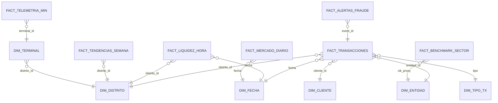
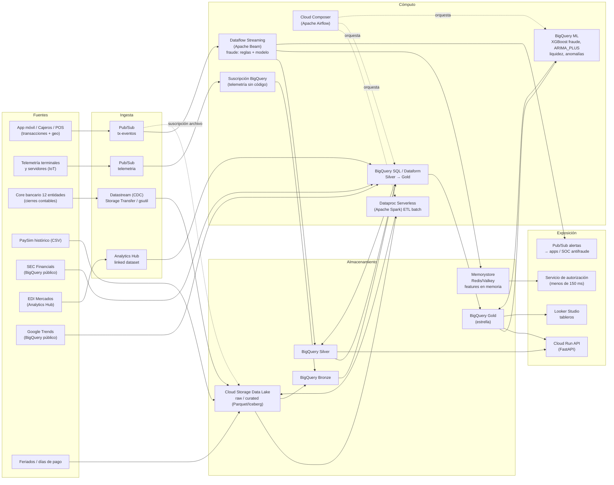
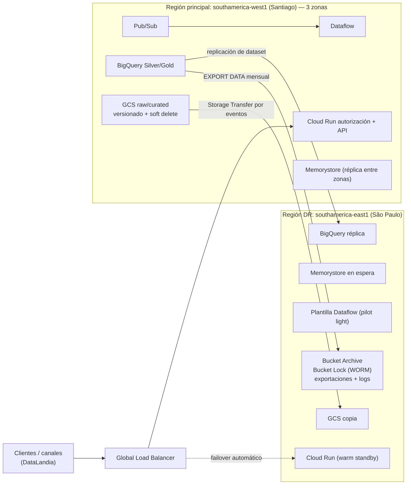

# Lumina Bank — Plataforma de Datos Big Data en Google Cloud

**Curso:** Taller de Arquitectura Big Data — UTEC, Ciclo 2026-2
**Caso:** DataBank Metropolitan / Iniciativa Financiera Lumina
**Entregable:** ENTREGA 1 — Examen (Sustentación técnica, económica y de resiliencia) + Proyecto Parte 1 (Blueprint, ingesta y almacenamiento)
**Fecha de entrega:** 24 de octubre de 2026
**Equipo:** _(completar)_

---

## Índice

1. Resumen ejecutivo para el Comité
2. Diagnóstico del negocio
3. Fuentes de datos y clasificación
4. Estrategia de integración multifuente (modelo de cruce)
5. Arquitectura end-to-end (Batch + Streaming)
6. Capa de ingesta
7. Capa de almacenamiento
8. Capa de procesamiento (adelanto de la Entrega 2)
9. Capa de exposición (adelanto de la Entrega 3)
10. Seguridad y gobernanza
11. Justificación del stack tecnológico
12. Escalabilidad y performance
13. Justificación económica y optimización de costos
14. Regiones, respaldos (backups), recuperación ante desastres y alta disponibilidad (DRP/HA)
15. KPIs, criterios de éxito y valor de negocio
16. Plan de implementación por entregas
17. Supuestos, dependencias, riesgos y fuera de alcance
18. Anexos

---

## 1. Resumen ejecutivo para el Comité

### 1.1 Mensaje para el Comité Ejecutivo (negocio y tecnología)

| | |
|---|---|
| **Problema** | 12 entidades con datos separados no pueden detectar fraude entre bancos, se congestionan en días de pago y no saben cuánto efectivo poner en cada cajero. Los informes llegan tarde y cada entidad los arma por su cuenta. |
| **Propuesta** | Una plataforma de datos única en Google Cloud. Decide sobre el fraude en milisegundos, pronostica la liquidez diaria por distrito y da a la gerencia indicadores actualizados cada 15 minutos. Cada entidad ve solo sus datos y comparte las señales de fraude. |
| **Beneficios esperados** | (1) Detectar el fraude **antes** de que salga el dinero. (2) Tener el efectivo justo en cada distrito (menos cajeros vacíos y menos dinero ocioso). (3) Informes en minutos en lugar de días. (4) Una plataforma que crece sola en Cyber Days y días de pago, sin comprar servidores. |
| **Inversión en nube, año 1** | **≈ USD 66,000** en la región de producción propuesta (Santiago), equivalente a **≈ USD 12 por millón de transacciones**. La referencia a precios de EE. UU. es ≈ USD 54,000. No incluye el equipo humano ni las licencias de terceros (sección 13). |
| **Resiliencia** | Región principal **Santiago (southamerica-west1)** y región de contingencia **São Paulo (southamerica-east1)**. Si se cae una región completa, la autorización de transacciones vuelve en **menos de 5 minutos sin perder transacciones**. Respaldos diarios, inmutables y guardados fuera de la región principal (sección 14). |
| **Riesgos principales** | Calidad de los datos de origen, normativa de residencia y tercerización en la nube (SBS), dependencia del proveedor (se mitiga con tecnologías open source) y madurez del equipo. Todos tienen mitigación (sección 17). |
| **Decisiones que se solicitan** | 1) Aprobar la arquitectura y el presupuesto de nube del año 1. 2) Aprobar Santiago como región principal y São Paulo como región de contingencia. 3) Aprobar el plan por fases (MVP de fraude → liquidez → informes) y los KPIs de éxito (sección 15). |

### 1.2 Resumen técnico

Lumina Bank une a **12 entidades financieras** que hoy trabajan por separado y atienden a **más de 9 millones de clientes** en **8 distritos**. Este documento propone el **back-end inteligente de datos** (el "RFP de Back-End" del caso). La plataforma corre por completo en **Google Cloud Platform (GCP)** y tiene dos caminos de procesamiento que comparten el mismo modelo de datos:

| Camino | Para qué sirve | Servicios GCP principales |
|---|---|---|
| **Streaming (tiempo real)** | Autorizar transacciones y detectar fraude (Vertical I), vigilar la salud de cajeros y servidores (Vertical IV) | Pub/Sub → Dataflow (Apache Beam) → Memorystore (Redis/Valkey) + BigQuery |
| **Batch (lotes)** | Cargar el histórico transaccional, los cierres contables, los datos de mercado (EDI), los estados financieros del sector (SEC) y las tendencias de búsqueda (Google Trends). Alimenta la liquidez diaria (Vertical II) y los informes (Vertical III) | Cloud Storage (Data Lake) → Dataproc Serverless (Spark) / BigQuery SQL → BigQuery (Lakehouse/DW), orquestado con Cloud Composer (Airflow) |

**Decisiones principales**

1. **Lakehouse medallion** (Bronze → Silver → Gold). Cloud Storage guarda los archivos crudos en formatos abiertos (CSV/Parquet/Iceberg) y BigQuery es el motor analítico y la capa de servicio.
2. **Kappa para el camino caliente y batch para el histórico.** Las transacciones en vivo y las históricas llegan a la **misma estructura** en Silver, así que los dos caminos producen las mismas métricas.
3. **Decisión en dos niveles.** La autorización síncrona (menos de 150 ms) consulta *features* precalculadas en memoria (Memorystore). Dataflow calcula esas *features* y lanza una segunda línea de detección asíncrona en pocos segundos.
4. **Componentes open source o con API abierta** (Beam, Spark, Airflow, Redis/Valkey, Iceberg, XGBoost). Así se cumple el requisito del caso y se reduce la dependencia de un proveedor.
5. **Costo estimado del primer año:** alrededor de **USD 5,500 al mes** en la región de Santiago con 15 % de contingencia (≈ USD 4,500 a precios de EE. UU.). Equivale a unos **USD 12 por millón de transacciones**. El detalle está en la sección 13.
6. **Dos regiones y respaldos inmutables.** El laboratorio corre en `US` para poder cruzar con los datasets públicos. Producción corre en Santiago con DR en São Paulo (sección 14).

---

## 2. Diagnóstico del negocio

### 2.1 De los desafíos a los requerimientos de datos

| Desafío del caso | Qué implica para la arquitectura | Vertical |
|---|---|---|
| Expansión digital: la mayoría de clientes solo usa canales digitales | Ingesta de eventos de App, cajeros y corresponsales a gran escala y con baja latencia | I, IV |
| Congestión en días de pago y cierres de mes | Servicios elásticos (autoscaling), procesamiento desacoplado con colas y precalentamiento de capacidad en fechas conocidas | I, IV |
| Desajuste demográfico (adultos mayores frente a jóvenes digitales) | Segmentación por edad, canal y distrito, y personalización en tiempo real | III, II |
| 12 entidades fragmentadas que no comparten información de fraude | Modelo de datos **unificado** con `entidad_id`, intercambio de señales de fraude y seguridad por fila para que cada entidad vea solo lo suyo | I, III |
| Red física subutilizada (el 89 % está a menos de 8 km de un punto) | Geolocalización de cajeros y agencias, análisis de congestión por distrito y hora, y propuesta de nuevos nodos | IV, II |

### 2.2 Verticales de servicio y casos de uso

| Vertical | Caso de uso | Latencia esperada | Camino |
|---|---|---|---|
| **I. Decisiones en tiempo real** | Puntaje de fraude por transacción (reglas + modelo), límites y saldo disponibles, viaje imposible por geolocalización | menos de 150 ms (síncrona) / menos de 5 s (alerta) | Streaming |
| **II. Planes diarios de liquidez** | Pronóstico de efectivo por distrito y cajero para el día siguiente, usando mercado, feriados y tendencias | Diario (T+1 antes de las 05:00) | Batch + ML |
| **III. Informes operativos bajo demanda** | Tiempo de aprobación, costo por transacción, ingreso por producto y salud financiera frente al sector (SEC) | Interactivo (segundos), frescura menor a 15 min | Batch + Streaming |
| **IV. Infraestructura** | Salud de terminales, predicción de caídas, rutas de congestión y nuevos nodos | menos de 1 min (monitoreo) / diario (predictivo) | Streaming + Batch |

### 2.3 Volumetría de referencia (supuestos de dimensionamiento)

| Variable | Supuesto | Valor |
|---|---|---|
| Clientes | Dato del caso | 9,000,000 |
| Clientes digitales activos | 70 % | 6,300,000 |
| Transacciones diarias (día normal) | ~2.4 tx por cliente activo | **15 M tx/día** (≈ 175 TPS en promedio) |
| Día de pago o cierre de mes | ×4 el volumen diario, con 12 % concentrado en la hora pico | **≈ 2,000 TPS** |
| Evento extremo (Cyber/Black Friday, campaña) | ×2.5 sobre el pico de pago | **Diseño: 5,000 TPS** |
| Telemetría de terminales | 5,000 cajeros/POS, 1 evento cada 30 s | 14.4 M eventos/día |
| Clickstream de la App | ~8 eventos por cliente activo | ~50 M eventos/día |
| Tamaño medio de evento (JSON) | — | 0.5–1 KB |
| **Ingesta streaming total** | — | **≈ 47 GB/día ≈ 1.4 TB/mes** |

---

## 3. Fuentes de datos y clasificación

Las fuentes públicas se verificaron con `bq ls` y `bq show` el 21/10/2026.

| # | Fuente | Tipo de dato | Velocidad | Formato / Acceso | Uso en el caso |
|---|---|---|---|---|---|
| F1 | **PaySim** (Kaggle `stealthknight/paysim`): ~6.36 M transacciones de banca móvil con etiqueta `isFraud` | **Transaccional** | Batch (histórico) **y** Streaming (se reproduce como flujo en vivo) | CSV → GCS. Columnas: `step, type, amount, nameOrig, oldbalanceOrg, newbalanceOrig, nameDest, oldbalanceDest, newbalanceDest, isFraud, isFlaggedFraud` | Vertical I (fraude), II (salidas de efectivo), III |
| F2 | **SEC Quarterly Financials** `bigquery-public-data.sec_quarterly_financials` (tablas `quick_summary`, `submission`, `numbers`, `sic_codes`, …; ~89.6 M filas en `quick_summary`) | **Financiero / contable** | Batch (trimestral; el dataset se actualizó por última vez en 2021) | BigQuery público (US). Campos clave: `company_name, measure_tag, value, sic, fiscal_year, fiscal_period_focus, central_index_key` | Vertical III: comparar con el sector bancario (SIC 6021/6022) |
| F3 | **Exchange Data International (EDI)**: precios de cierre, dividendos y acciones | **Mercado** | Batch (diario) | **Analytics Hub** → dataset enlazado en el proyecto | Vertical II (contexto de mercado y tipo de cambio), III |
| F4 | **Google Trends** `bigquery-public-data.google_trends.international_top_terms` (`country_code, region_name, region_code, term, week, score, rank, refresh_date`) y `top_terms` (por DMA de EE. UU.) | **Social / comportamiento** | Batch (semanal) | BigQuery público (US), particionado por `refresh_date` | Vertical II: demanda digital por distrito (se mapean regiones de Perú a distritos) |
| F5 | **Geolocalización de transacciones** (simulada al reproducir PaySim) | **Comportamiento** | Streaming | JSON → Pub/Sub | Vertical I (viaje imposible), IV (congestión) |
| F6 | **Telemetría de cajeros/POS/servidores** (simulada) | **Operacional / IoT** | Streaming | JSON → Pub/Sub | Vertical IV |
| F7 | **Calendario de feriados y días de pago** (Perú) | **Contexto** | Batch (anual) | CSV / tabla de referencia | Vertical II |
| F8 | **Cierres contables y saldos de cuentas** (core bancario de las 12 entidades; en el laboratorio se derivan de PaySim) | **Transaccional / contable** | Batch (diario, al cierre) | Archivos → GCS. En producción: CDC con **Datastream** | Vertical II, III |
| F9 | **Cloud Billing export** (costo real de la plataforma) | **Operacional / FinOps** | Batch (diario) | BigQuery | Vertical III: **costo operativo por transacción real** |

**Clasificación que pide el caso:**
- **Transaccional:** F1, F8
- **Comportamiento:** F4 (búsquedas), F5 (geolocalización y canal), clickstream
- **Social / contexto económico:** F3, F4, F7
- **Operacional / IoT:** F6, F9
- **Financiero sectorial:** F2

---

## 4. Estrategia de integración multifuente (modelo de cruce)

Las fuentes no comparten llaves naturales. La integración se apoya en **dimensiones conformadas** (Kimball) y en **reglas de enriquecimiento deterministas**. Una misma regla produce siempre el mismo resultado en Python, Spark y BigQuery, porque se usa el mismo hash MD5.

### 4.1 Llaves de cruce

| Llave conformada | Cómo se obtiene | Une |
|---|---|---|
| `cliente_id` | `nameOrig` de PaySim | Transacciones ↔ dim_cliente ↔ features en Memorystore |
| `distrito_id` (1–8) | `bucket(md5('d' + cliente_id), 8) + 1` | Transacciones ↔ dim_distrito ↔ Google Trends (región de Perú asignada a cada distrito) |
| `entidad_id` (1–12) | `bucket(md5('e' + cliente_id), 12) + 1` | Transacciones ↔ dim_entidad ↔ SEC (cada entidad tiene asignado un banco real del sector como *proxy* de estados financieros) |
| `fecha` / `hora` | `TIMESTAMP '2026-07-01' + step horas (julio incluye feriados del 23, 28 y 29 y dos días de pago)` (PaySim: 1 step = 1 hora, 744 steps ≈ 31 días) | Transacciones ↔ dim_fecha ↔ feriados ↔ EDI (precio de cierre del día) ↔ Trends (semana) |
| `terminal_id` | Catálogo sintético de 5,000 terminales repartidos en los 8 distritos | Telemetría ↔ dim_terminal ↔ transacciones de efectivo (CASH_IN/CASH_OUT) |
| `tipo` | `type` de PaySim (CASH_IN, CASH_OUT, DEBIT, PAYMENT, TRANSFER) | Transacciones ↔ dim_tipo_transaccion (comisión de referencia → ingreso por producto) |

> **Por qué un hash determinista:** el simulador de streaming (Python), el ETL batch (Spark) y las dimensiones (SQL) asignan el mismo distrito y la misma entidad a cada cliente sin consultar ninguna tabla. Así se puede cruzar en tiempo real sin hacer *lookups* costosos.
> `bucket(x, n) = int(primeros_8_hex(md5(x)), 16) mod n`

### 4.2 Modelo de datos analítico (Gold — estrella)



### 4.3 Advertencias metodológicas (para la sustentación)

- **PaySim es sintético y dura ~31 días.** Sirve para entrenar fraude y para pronósticos **horarios** a 24 h. No sirve para estacionalidad anual. Para el pronóstico de liquidez se usan series horarias por distrito (744 puntos).
- **La geolocalización es simulada.** El simulador ubica algunas transacciones fraudulentas lejos del domicilio del cliente. Por eso la regla de "viaje imposible" se presenta como **demostración del mecanismo**, no como métrica de desempeño. El modelo de ML se entrena **sin** variables geográficas para no filtrar la etiqueta (*label leakage*).
- En PaySim, `nameOrig` casi no se repite (cada cliente aparece ~1 vez), mientras que `nameDest` sí se repite. Por eso las *features* de velocidad se calculan **por destino**, que es la señal de una cuenta "mula".
- **Google Trends** publica los términos más buscados, no solo los financieros. Se filtran términos financieros (préstamo, banco, bono, AFP, retiro, tarjeta, CTS, gratificación, …) y el `score` agregado se usa como indicador de actividad digital por región.
- **SEC** cubre bancos de EE. UU. hasta 2021. Se usa como **benchmark sectorial** de ratios (ROA, apalancamiento), no como dato de Lumina.
- **BigQuery solo permite cruzar datasets en la misma ubicación.** Los datasets públicos están en `US`, así que los datasets del proyecto se crean en `US` (multirregión).

---

## 5. Arquitectura end-to-end (Batch + Streaming)

### 5.1 Diagrama



### 5.2 Capas

| Capa | Responsabilidad | Servicios |
|---|---|---|
| **Ingesta** | Capturar eventos y archivos, desacoplar productores y consumidores, permitir reprocesar | Pub/Sub, Storage Transfer, Datastream, Analytics Hub, `bq`/`gcloud storage` |
| **Cómputo** | Limpieza, enriquecimiento, cruce, *scoring* y agregaciones | Dataflow (Beam), Dataproc Serverless (Spark), BigQuery SQL/Dataform, BigQuery ML |
| **Almacenamiento** | Lake crudo y curado, Lakehouse/DW analítico y *store* en memoria | Cloud Storage, BigQuery (Bronze/Silver/Gold), Memorystore |
| **Exposición** | APIs, tableros, alertas y modelos | Cloud Run, Looker Studio, Pub/Sub (alertas), vistas autorizadas |
| **Transversal** | Orquestación, seguridad, gobierno, observabilidad, IaC | Composer, IAM, KMS, Sensitive Data Protection (DLP), Dataplex, VPC-SC, Cloud Monitoring/Logging, Terraform |

### 5.3 Flujos principales

**Flujo streaming — fraude (Vertical I)**
1. El canal (App, cajero, POS) publica la transacción en `tx-eventos` (Pub/Sub), con `cliente_id`, monto, saldos, canal, lat/lon y `device_id`.
2. **Dataflow** lee, valida el esquema y descarta duplicados por `event_id`. Luego calcula *features* con estado por cliente (última ubicación → velocidad km/h) y por destino (conteo en 10 min → patrón de cuenta mula). Aplica las reglas y el modelo, y emite `score` y `decision` (APROBAR / REVISAR / BLOQUEAR).
3. Salidas: (a) `lumina_silver.transacciones_stream` en BigQuery, (b) `lumina_silver.alertas_fraude` y el tópico `alertas-fraude`, (c) *features* actualizadas en **Memorystore** para el servicio de autorización síncrona.
4. Una suscripción adicional de Pub/Sub → **Cloud Storage** (suscripción de archivo) guarda el evento crudo en el lake. Sirve para auditoría y para reprocesar.

**Flujo streaming — telemetría (Vertical IV)**
1. Las terminales publican en `telemetria`. Una **suscripción BigQuery** escribe directo en Bronze, sin código ni workers.
2. Vistas y consultas programadas agregan por minuto y por terminal. `ML.DETECT_ANOMALIES` marca terminales con latencia o temperatura anómalas.

**Flujo batch — histórico y cierres (Verticales II y III)**
1. Los archivos (PaySim histórico, cierres contables, feriados) llegan a `gs://<proyecto>-lumina-raw/`.
2. **Dataproc Serverless (Spark)** limpia, tipa y enriquece (distrito, entidad, timestamp) y escribe **Parquet particionado** en `gs://<proyecto>-lumina-curated/`.
3. Se carga en `lumina_silver.transacciones_batch`. Luego **SQL en BigQuery** cruza con SEC, EDI y Trends y construye Gold (estrella).
4. **BigQuery ML** reentrena y predice: fraude (semanal) y liquidez (diaria, T+1).
5. **Composer (Airflow)** orquesta todo con reintentos, SLA y alertas.

### 5.4 Patrón arquitectónico elegido

- **Medallion (Bronze/Silver/Gold)** para la calidad progresiva del dato y su trazabilidad.
- **Lambda simplificada / Kappa en el camino caliente.** El *stream* no se recalcula en batch. El batch sí carga la historia y los cierres, que **por naturaleza** llegan por lotes. Ambos caminos escriben en Silver con el **mismo esquema**, y Gold une los dos (`origen = 'batch' | 'stream'`).
- **Separación de cómputo y almacenamiento.** Cada capa escala por su cuenta y se paga por uso.

---

## 6. Capa de ingesta

| Fuente | Mecanismo | Frecuencia | Servicio GCP | Formato | Destino (landing) |
|---|---|---|---|---|---|
| Transacciones en vivo (F1 en reproducción, F5) | **Push de eventos** | Continuo | **Pub/Sub** `tx-eventos` (retención 7 días, *ordering key* = `cliente_id` si se necesita orden) | JSON (esquema Avro registrado en Pub/Sub en producción) | Dataflow + suscripción a GCS |
| Telemetría (F6) | Push de eventos | Cada 30 s por terminal | **Pub/Sub** `telemetria` + **suscripción BigQuery** | JSON | `lumina_bronze.telemetria_raw` |
| PaySim histórico (F1) | Carga de archivo | Una vez + reprocesos | `gcloud storage cp` / Storage Transfer Service | CSV | `gs://…-raw/paysim/` |
| Cierres contables (F8) | **CDC** desde las bases del core | Continuo (CDC) o diario | **Datastream** → GCS/BigQuery (prod); archivo diario (lab) | Avro/JSON | `gs://…-raw/cierres/` |
| SEC (F2) | **Consulta federada directa** (sin copiar) | Trimestral | BigQuery (dataset público) | Tabla | Se lee en el ELT y se materializa en Gold |
| EDI (F3) | **Suscripción Analytics Hub** | Diario (lo actualiza el proveedor) | Analytics Hub → *linked dataset* | Tabla | `lumina_bronze.mercado_precios` → vista `lumina_gold.fact_mercado_diario` |
| Google Trends (F4) | Consulta directa | Semanal | BigQuery (dataset público) | Tabla | Se materializa en Gold |
| Feriados (F7) | Carga de archivo | Anual | GCS + `bq load` | CSV | `lumina_bronze.feriados` |
| Billing (F9) | Exportación nativa | Diario | Cloud Billing export | Tabla | `billing_export` |

**Garantías de ingesta:**
- *At-least-once* en Pub/Sub, más **deduplicación por `event_id`** en Dataflow, para lograr un efecto *exactly-once* en el destino.
- **Dead-letter topic** (`tx-eventos-dlq`) para mensajes que no pasan validación, con máximo 5 intentos de entrega.
- **Esquema de tópico** (Avro/Protobuf) en producción para rechazar mensajes malformados en el borde.
- **Replay:** `gcloud pubsub subscriptions seek` a un *snapshot* o a una fecha (hasta 7 días) y los archivos crudos en GCS (sin límite).

---

## 7. Capa de almacenamiento

### 7.1 Motores por tipo de carga

| Necesidad | Motor | Por qué |
|---|---|---|
| **Alta velocidad (InMemory)**: saldo disponible, límites y *features* del cliente para autorizar en menos de 10 ms | **Memorystore for Redis Cluster / Valkey** (open source) | Latencia de submilisegundos, réplica con *failover* automático, API Redis estándar y portable |
| **Gran volumen (Data Lake)**: crudos, curados y archivo histórico | **Cloud Storage** (zonas `raw`, `curated`, `archive`), formatos abiertos **Parquet / Apache Iceberg** (BigLake) | Barato, durable (11 nueves), ciclo de vida automático y legible por Spark, Beam y BigQuery |
| **Lakehouse / Data Warehouse**: modelo analítico, BI y ML | **BigQuery** (Bronze/Silver/Gold) | Serverless, separa almacenamiento y cómputo, SQL estándar, ML integrado y seguridad por columna y fila |
| **NoSQL de series temporales a gran escala** (evolución) | **Bigtable** (API HBase, open source) | Para cuando la telemetría supere decenas de miles de eventos/s con lecturas por llave. **No se incluye en el año 1** por costo |

### 7.2 Diseño en BigQuery (laboratorio: `US`; producción: `southamerica-west1`, ver 14.2)

| Dataset | Tabla / vista | Partición | Clustering | Retención |
|---|---|---|---|---|
| `lumina_bronze` | `paysim_raw` (externa sobre GCS), `telemetria_raw`, `feriados`, `mercado_precios` | `telemetria_raw`: DAY(`publish_time`) | `terminal_id` | 90 días (después solo en el lake) |
| `lumina_silver` | `transacciones_batch`, `transacciones_stream`, `alertas_fraude` | DAY(`event_ts`) | `distrito_id, tipo, cliente_id` | 2 años activa, luego *long-term storage* automático |
| `lumina_gold` | `dim_*`, `fact_transacciones` (vista unificada), `fact_liquidez_hora`, `fact_tendencias_semana`, `fact_benchmark_sector`, `fact_mercado_diario`, `v_kpi_*` | DAY(`fecha`) | `distrito_id, entidad_id` | Plazo regulatorio de conservación (referencia: 10 años, a confirmar con Cumplimiento) |
| `lumina_ml` | `modelo_fraude`, `modelo_liquidez`, `pronostico_liquidez` | — | — | Versionado |

### 7.3 Zonas del Data Lake

```
gs://<proyecto>-lumina-raw/        # inmutable, tal cual llega (CSV/JSON/Avro)
   paysim/  cierres/  feriados/  stream-archive/tx-eventos/YYYY/MM/DD/HH/
gs://<proyecto>-lumina-curated/    # limpio y tipado, Parquet particionado por fecha
   transacciones/fecha=YYYY-MM-DD/
gs://<proyecto>-lumina-archive/    # ciclo de vida: Nearline 30 d → Coldline 90 d → Archive 365 d
```

---

## 8. Capa de procesamiento (adelanto de la Entrega 2)

### 8.1 Streaming — `fraud_streaming_pipeline.py` (Apache Beam en Dataflow)

| Paso | Lógica |
|---|---|
| Parseo y validación | JSON → dict, tipado, envío a DLQ si falta algún campo |
| Deduplicación | Por `event_id` (atributo `id_label` de Pub/Sub) |
| Estado por cliente | Última (ts, lat, lon) → velocidad en km/h → **R4 viaje imposible** (> 800 km/h) |
| Estado por destino | Transacciones recibidas en 10 min → **R5 cuenta mula** (≥ 3) |
| Reglas sin estado | **R1 vaciado de cuenta** (TRANSFER/CASH_OUT con `monto ≈ saldo_ant_orig` y saldo final 0), **R2 inconsistencia en el libro del destino**, **R3 monto alto** (> 200,000) |
| Modelo | XGBoost entrenado en BigQuery ML y exportado a GCS (`EXPORT MODEL`), cargado en los workers (fase 2) |
| Decisión | `score ≥ 0.8` BLOQUEAR, `≥ 0.5` REVISAR, si no APROBAR, y `latencia_ms` |
| Sinks | BigQuery (todas), BigQuery + Pub/Sub (alertas), Memorystore (*features*) |

### 8.2 Batch — `batch_paysim_etl.py` (Spark en Dataproc Serverless) + SQL

- Limpieza: tipos, nulos, montos negativos, duplicados, y columnas de error de saldo (`err_saldo_orig`, `err_saldo_dest`).
- Enriquecimiento: `event_ts`, `distrito_id`, `entidad_id`, segmento etario y canal.
- Gold: estrella, liquidez horaria por distrito, tendencias semanales por distrito, benchmark SEC (ROA = `NetIncomeLoss / Assets`, apalancamiento = `Liabilities / Assets`).

### 8.3 ML (BigQuery ML)

| Modelo | Tipo | Entrada | Salida |
|---|---|---|---|
| Fraude | `BOOSTED_TREE_CLASSIFIER` (XGBoost), `auto_class_weights` (fraude ≈ 0.13 %) | TRANSFER y CASH_OUT, montos, saldos, errores de saldo, hora | Probabilidad. Métricas: AUC-PR, recall, precisión |
| Liquidez | `ARIMA_PLUS` multiserie (`time_series_id_col = distrito_id`), con feriados | Salidas de efectivo por hora y distrito | Pronóstico a 24 h con intervalos de confianza → plan de efectivo T+1 |
| Anomalías de infraestructura | `ARIMA_PLUS` + `ML.DETECT_ANOMALIES` | Latencia y errores por terminal | Terminales en riesgo de caída |

---

## 9. Capa de exposición (adelanto de la Entrega 3)

| Consumidor | Mecanismo | Ejemplo |
|---|---|---|
| Apps / front-end | **Cloud Run API (FastAPI)** detrás de API Gateway | `GET /clientes/{id}/riesgo`, `GET /alertas?desde=`, `GET /liquidez/{distrito}/pronostico`, `GET /kpis` |
| Autorización síncrona | Servicio en Cloud Run que lee Memorystore | Responde en menos de 150 ms (p95) |
| Analistas y gerencia | **Looker Studio** sobre vistas `v_kpi_*` (con **BI Engine** si hace falta) | Tablero operativo, de fraude, de liquidez y de infraestructura |
| SOC antifraude | Suscripción a `alertas-fraude` | Push a webhook o cola de casos |
| Cada entidad (12) | **Vistas autorizadas + Row-Level Security** por `entidad_id` | Cada banco ve solo su información, y la señal de fraude se comparte de forma anónima |

---

## 10. Seguridad y gobernanza

| Control | Implementación en GCP |
|---|---|
| **Cifrado en reposo** | Por defecto (AES-256) + **CMEK con Cloud KMS** en buckets, datasets, Pub/Sub y Dataflow, con rotación cada 90 días |
| **Cifrado en tránsito** | TLS 1.2+ en todas las APIs y Private Google Access |
| **Datos sensibles (PII)** | **Sensitive Data Protection (DLP)**: inspección y **tokenización determinista** (FPE/AES-SIV) de `cliente_id`, `device_id` y cuentas. Las coordenadas se redondean a 3 decimales en Gold |
| **Seguridad por columna** | **Policy tags** de Dataplex/Data Catalog (`PII_ALTA`: montos y saldos por cliente; `PII_MEDIA`: geo), con enmascaramiento dinámico para analistas |
| **Seguridad por fila** | Row Access Policies por `entidad_id` (12 entidades) |
| **Perímetro** | **VPC Service Controls** alrededor de BigQuery, GCS, Pub/Sub y Dataflow (evita la exfiltración), Private Service Connect y workers sin IP pública |
| **Identidad** | Cuentas de servicio por componente con mínimo privilegio, Workload Identity y **Secret Manager** |
| **Auditoría** | Cloud Audit Logs (Data Access) → sink a BigQuery, retención de 1 año o más |
| **Calidad y linaje** | **Dataplex**: *data quality scans* (nulos, rangos, unicidad de `event_id`), linaje automático BigQuery/Dataflow y catálogo |
| **Cumplimiento** | Ley N.° 29733 de Protección de Datos Personales (Perú), regulación de seguridad de la información y ciberseguridad de la SBS y principios PCI DSS para datos de tarjetas |

---

## 11. Justificación del stack tecnológico

| Componente | Elección GCP | Alternativa evaluada | Por qué esta elección | Equivalente open source / portabilidad |
|---|---|---|---|---|
| Mensajería | **Pub/Sub** | Managed Service for Apache Kafka | Serverless sin particiones que dimensionar, escala automática a millones de msg/s, retención y *seek*. Para el año 1 tiene menos operación que Kafka | Si se necesita portabilidad total se migra a Kafka gestionado (Beam abstrae el conector) |
| Procesamiento streaming | **Dataflow** | Dataproc + Spark Structured Streaming / Flink | Autoscaling horizontal, Streaming Engine, *exactly-once*, estado y *timers* gestionados, *update* sin pérdida | **Apache Beam**: el mismo código corre en Flink o Spark |
| Procesamiento batch | **Dataproc Serverless (Spark)** + **BigQuery SQL** | Dataflow batch | Spark es el estándar del mercado y el equipo lo conoce. Serverless: se paga por job sin mantener clúster. El SQL en BigQuery evita mover datos | **Apache Spark**, SQL ANSI |
| Data Lake | **Cloud Storage** + Parquet/Iceberg | — | Barato, durable y con formatos abiertos | Iceberg / Parquet |
| DW / Lakehouse | **BigQuery** | Dataproc + Hive / AlloyDB | Serverless, petabyte-scale, ML integrado, seguridad fina y conexión nativa a datasets públicos y Analytics Hub (SEC, Trends, EDI) | Las tablas BigLake Iceberg son legibles por Spark y Trino |
| InMemory | **Memorystore (Redis Cluster / Valkey)** | Bigtable, Firestore | Submilisegundos para *features* y límites, HA con réplica | **Redis / Valkey** |
| ML | **BigQuery ML** (+ Vertex AI en producción) | Spark MLlib | Entrenar donde están los datos. Exporta XGBoost y TensorFlow | **XGBoost** |
| Orquestación | **Cloud Composer** | Workflows + Scheduler | DAGs con dependencias, reintentos, SLA y backfills | **Apache Airflow** |
| Exposición | **Cloud Run** + Looker Studio | GKE, App Engine | Contenedores serverless que escalan a 0 y bajo costo | Contenedor estándar (Docker) |
| Gobierno | **Dataplex**, DLP, KMS, VPC-SC | — | Nativos e integrados | — |
| IaC | **Terraform** | Deployment Manager | Estándar de la industria y reproducible para DRP | Terraform / OpenTofu |

---

## 12. Escalabilidad y performance

### 12.1 Cómo responde cada capa a un pico (día de pago, Cyber/Black Friday)

| Capa | Mecanismo de escala | Configuración |
|---|---|---|
| Pub/Sub | Escala automática sin particiones. Absorbe ráfagas y desacopla productores de consumidores (*buffer* de hasta 7 días) | Pedir de antemano aumentos de cuota de *throughput* por región |
| Dataflow | **Autoscaling horizontal** + **Streaming Engine** (el estado vive fuera del worker y el reescalado es rápido) + *vertical autoscaling* | `max_num_workers=30`, `min_num_workers=2`. Composer sube el mínimo (`--update`) 2 h antes de días de pago conocidos (**precalentamiento**) |
| Llaves calientes | Hay comercios y destinos con muchas transacciones | `with_hot_key_fanout` en agregaciones y sal en la llave cuando hace falta |
| BigQuery | Slots serverless (*on-demand* hasta ~2,000 slots por proyecto) o **Editions con autoscaling** de slots | Particionado y clustering para leer solo lo necesario, **vistas materializadas** para KPIs y BI Engine para tableros |
| Ingesta en BigQuery | Storage Write API (hasta GB/s por proyecto) | Lotes de 500 a 1,000 filas |
| Memorystore | **Modo clúster**: se agregan *shards* en línea | 3 *shards* + réplica. Uso esperado: 25k ops/s, capacidad de más de 100k ops/s |
| Cloud Run | Autoscaling por concurrencia | `min-instances=2` (sin *cold start*), `max-instances=100`, concurrencia 80 |
| Dataproc Serverless | Escala de executors dinámica | *Spot* para batch no crítico |

### 12.2 Capacidad estimada en el pico de diseño (5,000 TPS de transacciones + ~10,000 eventos/s de telemetría y clicks)

- Un worker de Dataflow `n2-standard-4` procesa, como referencia conservadora, ~1,500–2,000 eventos/s con estado. Se necesitan **≈ 8–12 workers**, y el máximo configurado es 30, así que queda un margen de 2.5×.
- BigQuery Storage Write API: 15,000 filas/s × 1 KB ≈ 15 MB/s, muy por debajo del límite.
- Memorystore: 5,000 TPS × 5 lecturas/escrituras = 25,000 ops/s.

### 12.3 Plan de pruebas de carga

1. Con el simulador (`publish_transactions.py --rate`) se sube de forma escalonada: 100 → 500 → 2,000 → 5,000 eventos/s.
2. Se mide la latencia `ingest_ts → decision_ts` (p50/p95/p99), el *backlog* de Pub/Sub (`oldest_unacked_message_age`), el *system lag* de Dataflow y el uso de CPU.
3. Criterio de aceptación: p95 menor a 5 s extremo a extremo y *backlog* menor a 60 s en el pico.

---

## 13. Justificación económica y optimización de costos

### 13.1 Estimación mensual en producción (año 1)

> Estimación de referencia con precios de lista de GCP (región US / us-central1), sin descuentos negociados. **Se debe validar en el Google Cloud Pricing Calculator.** La volumetría es la de la sección 2.3.

| Servicio | Base de cálculo | USD/mes |
|---|---|---|
| Pub/Sub | 1.4 TB publicados + 2.8 TB entregados (2 suscripciones) ≈ 4.2 TiB × $40/TiB | 170 |
| Dataflow streaming | ~4 workers promedio (2 vCPU/7.5 GB) 24×7 + Streaming Engine + picos | 1,100 |
| Dataproc Serverless batch | ~24 DCU-h/día × $0.06 + shuffle | 60 |
| BigQuery almacenamiento | ~9 TB promedio en el año (activo + *long-term*) | 200 |
| BigQuery cómputo | ~40 TiB/mes escaneados *on-demand* ($6.25/TiB) | 250 |
| BigQuery Storage Write API | 1.4 TB/mes (los primeros 2 TiB/mes son gratuitos) | 35 |
| BigQuery ML | Reentrenamientos semanales y diarios | 100 |
| Memorystore (Redis Cluster/Valkey, ~12 GB con réplica) | 24×7 | 600 |
| Cloud Storage (bucket regional + copia en la región DR + ciclo de vida) | ~17 TB al cierre del año, la mayoría en Nearline/Coldline | 250 |
| Cloud Composer 3 (entorno pequeño) | 24×7 | 400 |
| Cloud Run (API + autorización) + Load Balancer | `min-instances` 2 | 80 |
| Sensitive Data Protection + Dataplex DQ | Inspección por muestreo | 150 |
| KMS + Secret Manager | Claves y operaciones | 20 |
| Cloud Logging / Monitoring | Ingesta de logs con exclusiones | 150 |
| Red / egress | Mínimo, casi todo intra-región | 80 |
| DR y respaldos (réplica de datasets críticos, copias de buckets, snapshots, exportaciones inmutables, Cloud Run y Memorystore mínimos en la región DR) | Almacenamiento duplicado de Silver/Gold + capacidad en espera | 250 |
| **Subtotal** | | **≈ 3,900** |
| Contingencia 15 % | | ≈ 600 |
| **Total mensual** | | **≈ USD 4,500** |
| **Total año 1** | | **≈ USD 54,000** |

**Escenario de producción en la región propuesta (Santiago, `southamerica-west1`).** Los precios de lista en las regiones de Sudamérica suelen estar por encima de `us-central1`. Con un ajuste referencial de **+20 a 25 %**, que hay que validar servicio por servicio en el Pricing Calculator:

| Escenario | USD/mes | USD/año 1 | USD por millón de tx |
|---|---|---|---|
| Referencia, precios de EE. UU. | ≈ 4,500 | ≈ 54,000 | ≈ 10 |
| **Producción en Santiago + DR en São Paulo (recomendado)** | **≈ 5,500** | **≈ 66,000** | **≈ 12** |

> El presupuesto **solo cubre consumo de nube**. No incluye el equipo (ingeniería de datos, SRE, seguridad), el soporte de Google Cloud, Looker (si se elige en lugar de Looker Studio) ni los datos de mercado de pago (EDI).

### 13.2 Costo por transacción

- Transacciones al mes: 15 M/día × 30 = **450 M**
- **Costo por transacción** ≈ 5,500 / 450,000,000 ≈ **USD 0.000012** (**≈ USD 12 por millón de transacciones** en Santiago y ≈ USD 10 a precios de EE. UU.). Este número ya incluye fraude en tiempo real, analítica, ML, respaldos y DR.
- **Economía de escala:** los componentes serverless (Pub/Sub, BigQuery, Dataflow) crecen menos que proporcionalmente, porque los costos fijos (Composer, Memorystore base, Cloud Run mínimo) se reparten. Con **el doble de volumen** el costo mensual sube ~60 % y el costo por transacción **baja a ≈ USD 8 por millón**.
- **Medición real:** la vista `v_kpi_costo_por_tx` cruza el **Billing export** con el conteo de transacciones procesadas. Así el KPI "costo operativo por transacción" del caso (Vertical III) se mide, no solo se estima.

### 13.3 Palancas de optimización

1. **BigQuery:** partición y clustering obligatorios (`require_partition_filter`), vistas materializadas para KPIs, nada de `SELECT *`, cuotas por usuario y proyecto (*custom quotas*), **facturación por almacenamiento físico** (comprimido) y pasar a **Editions con compromiso** cuando el gasto *on-demand* supere de forma sostenida el costo de la reserva base.
2. **Dataflow:** Streaming Engine, autoscaling con mínimo bajo fuera de picos, **FlexRS** para batch (hasta ~40 % menos) y máquinas del tamaño justo.
3. **Telemetría sin cómputo:** la suscripción BigQuery directa elimina un pipeline Dataflow, lo que ahorra unos USD 300–400 al mes.
4. **Cloud Storage:** ciclo de vida Standard → Nearline (30 d) → Coldline (90 d) → Archive (365 d).
5. **Dataproc Serverless:** se paga solo por job, con *Spot* en procesos no críticos.
6. **Committed Use Discounts** (1 o 3 años) sobre Dataflow y Memorystore a partir del año 2 (entre 20 y 55 %).
7. **FinOps:** etiquetas (`env`, `capa`, `vertical`) en todos los recursos, presupuestos con alertas al 50/90/100 % y tablero de costos.

### 13.4 Costo del laboratorio (implementación académica)

| Recurso | Uso en el laboratorio | Costo aproximado |
|---|---|---|
| Dataflow streaming (1–2 workers `n1-standard-2`) | Encendido solo durante pruebas y demo (~20 h) | USD 8–15 |
| Dataproc Serverless | 3–5 ejecuciones | USD 2–5 |
| BigQuery | Menos de 1 TiB escaneado (cubierto por el free tier mensual) + almacenamiento ~5 GB | USD 0–5 |
| Pub/Sub, GCS, Cloud Run | Volumen pequeño | menos de USD 3 |
| Memorystore / Composer | **Opcional**: crear solo para la demo y destruir al terminar | USD 5–15 |
| **Total** | | **≈ USD 20–45** (cubierto por el crédito de prueba de USD 300) |

---

## 14. Regiones, respaldos (backups), recuperación ante desastres y alta disponibilidad (DRP/HA)

### 14.1 Conceptos clave, en lenguaje de negocio

| Concepto | Qué significa para Lumina | Cómo se cubre |
|---|---|---|
| **Alta disponibilidad (HA)** | El servicio sigue funcionando si falla un servidor o un centro de datos (zona) | Servicios multizona dentro de la región principal, sin intervención humana |
| **Recuperación ante desastres (DR)** | El servicio vuelve si se pierde una región completa (Santiago) | Región de contingencia en São Paulo con réplicas y procedimientos probados |
| **Respaldo (backup)** | Una copia **separada, versionada e inmutable** para volver atrás ante un borrado, un error humano, corrupción o ransomware | Snapshots, versionado y exportaciones con bloqueo WORM (14.4) |
| **Punto de recuperación (RPO)** | Cuánta información se puede perder como máximo: la antigüedad del último punto desde el que se puede restaurar | Depende de la frecuencia del respaldo o de la réplica (14.3) |
| **Tiempo de recuperación (RTO)** | Cuánto tiempo puede estar caído el servicio | Depende de la estrategia de DR elegida para cada nivel (14.3) |

> **Una réplica no es un respaldo.** La réplica copia también los errores: si alguien borra una tabla, el borrado se replica. Por eso la arquitectura usa **las dos cosas**: réplicas para la disponibilidad y respaldos inmutables para recuperar el dato.

### 14.2 Estrategia de regiones de implementación

| Entorno | Región | Uso | Justificación |
|---|---|---|---|
| **Producción, región principal** | **`southamerica-west1` (Santiago)** | Ingesta, streaming, autorización, Lakehouse y API | Región de Google Cloud más cercana a los clientes de DataLandia (Perú). Menor latencia que las regiones de EE. UU. y datos en Sudamérica |
| **Producción, región de contingencia (DR)** | **`southamerica-east1` (São Paulo)** | Réplicas de datos, respaldos fuera de la región principal y servicios en espera | Está a más de 2,500 km de Santiago, así que los riesgos geográficos y de red son independientes. Tiene el mismo portafolio de servicios |
| **Respaldo de largo plazo** | `southamerica-east1`, clase Archive, con Bucket Lock | Copias inmutables de largo plazo | Están fuera de la región principal, son WORM y tienen el menor costo de almacenamiento |
| **Laboratorio académico (Entregas 2 y 3)** | `US` (multirregión) / `us-central1` | Demo y pruebas | Los datasets públicos (SEC, Trends) están en `US`, y BigQuery **no cruza tablas de ubicaciones distintas** |
| **Datos de referencia públicos en producción** | De `US` a Santiago | Copia semanal | Se copian a Santiago con **BigQuery Data Transfer Service (dataset copy)** o con una consulta programada de extracción. Así el cruce se hace dentro de la región principal |



**Residencia de datos y regulación.** Los datos personales se protegen según la Ley N.° 29733 y su reglamento. Para enviarlos fuera del Perú (Chile y Brasil) se aplica el régimen de **flujo transfronterizo** de esa ley y la tercerización en la nube se gestiona según la normativa de la SBS (Res. SBS N.° 504-2021). **Cumplimiento y Legal deben validar ambos puntos antes de la puesta en producción.** Si Google Cloud habilita una región en Perú, se evaluará moverla a región principal.

### 14.3 Niveles de criticidad, RPO/RTO y estrategia de DR

| Nivel | Servicios | RTO | RPO | Estrategia de DR | Qué existe en São Paulo antes del desastre |
|---|---|---|---|---|---|
| **Tier 0** | Autorización y fraude en tiempo real | **menos de 5 min** | **≈ 0** | **Warm standby (activo-pasivo)** | Cloud Run de autorización desplegado y detrás del balanceador global, Memorystore pequeño encendido y reglas sin estado listas |
| **Tier 1** | Analítica streaming, alertas y telemetría | 1 h | 15 min | **Pilot light** | Plantilla Flex de Dataflow publicada, tópicos y suscripciones creados, datasets réplica de BigQuery |
| **Tier 2** | Batch, liquidez T+1 e informes | 24 h | 24 h | **Backup & restore** | Respaldos diarios, Terraform y DAGs en Git |

**Por qué el RPO del Tier 0 es ≈ 0:** Pub/Sub confirma un mensaje al productor solo después de guardarlo de forma sincrónica en al menos dos zonas. Además, el mensaje se conserva 7 días hasta que el consumidor lo confirma. Una transacción aceptada no se pierde aunque el procesamiento se caiga: se reprocesa al relanzarlo.

### 14.4 Política de respaldos (backups)

| Activo | Mecanismo de respaldo | Frecuencia | Retención | Ubicación | Inmutable |
|---|---|---|---|---|---|
| Tablas BigQuery (Silver/Gold) | **Time travel** + **fail-safe** | Continuo | 7 días + 7 días | Región principal | Sí (lo gestiona Google) |
| Tablas Gold y dimensiones | **Table snapshots** (solo se cobran los cambios) | Diaria, más una mensual | 35 días las diarias y 13 meses las mensuales | Región principal y dataset réplica | Solo lectura |
| Silver y Gold completos | **Replicación de dataset entre regiones** (asíncrona) | Continua | Igual que el origen | São Paulo | No (es réplica, no respaldo) |
| Silver y Gold (histórico regulatorio) | **Exportación** a Parquet/Avro (`EXPORT DATA`) | Mensual, más un cierre anual | Plazo regulatorio (referencia: 10 años) | Bucket Archive en São Paulo | **Sí: Bucket Lock (WORM)** |
| Data Lake `raw` / `curated` | **Versionado de objetos** + **soft delete** | Continuo | 30 días de versiones y borrados | Región principal | Recuperable |
| Data Lake `raw` / `curated` | **Copia entre regiones** (Storage Transfer Service con transferencias por eventos) | Continua (minutos) | Igual que el origen | São Paulo | Retención bloqueada en `raw` |
| Eventos en vuelo (Pub/Sub) | Retención de mensajes + **snapshots** antes de cada despliegue | Continua y en cada despliegue | 7 días | Multizona | — |
| Estado de Dataflow | **Dataflow snapshots** antes de cada actualización del job | En cada despliegue | 7 días | Región principal | — |
| *Features* en memoria (Memorystore) | Persistencia **RDB** + reconstrucción desde BigQuery/Pub/Sub | Cada hora | 24 h | Región principal | — |
| Orquestación (Composer) | **Snapshots del entorno** + DAGs en Git | Diaria | 30 días | Bucket en São Paulo | — |
| Código, infraestructura y modelos | Git (GitHub), Artifact Registry, estado de Terraform en bucket versionado, modelos exportados a GCS | En cada cambio | Indefinida | Multi-región | Historial de Git |
| Logs de auditoría | Sink de logs a bucket con retención bloqueada | Continua | 1 año o más | São Paulo | **Sí** |
| Claves de cifrado (Cloud KMS) | Las claves no se exportan: se protegen con IAM separado y destrucción diferida | — | Destrucción programada a 30 días | Una clave por región | — |

**Regla 3-2-1-1 aplicada:** **3** copias (producción, réplica y exportación), en **2** servicios distintos (BigQuery y Cloud Storage), **1** fuera de la región principal (São Paulo) y **1** inmutable (Bucket Lock). Esto también protege contra ransomware y contra borrados de un administrador.

> **Riesgo crítico, la pérdida de la clave:** si se destruye una clave CMEK, el dato cifrado con ella no se puede recuperar. Por eso hay segregación de funciones: quien administra las claves no administra los datos. Además la destrucción tiene un plazo de 30 días y una alerta.

### 14.5 Estrategia por componente

| Componente | Alta disponibilidad (fallo de zona) | Recuperación ante desastre (fallo de región) |
|---|---|---|
| Pub/Sub | Servicio global y multizona por diseño | Mensajes retenidos 7 días + *snapshots*. Los productores publican al *endpoint* de São Paulo |
| Dataflow | Workers multizona. Streaming Engine guarda el estado fuera de los workers | Se relanza la **Plantilla Flex** versionada en São Paulo y se reprocesa desde la suscripción. El estado se reconstruye solo |
| Memorystore | Réplica con *failover* automático entre zonas | Instancia en espera en São Paulo, que se calienta desde BigQuery. Mientras tanto, la autorización trabaja en **modo degradado** (reglas sin estado y límites conservadores) |
| BigQuery | Almacenamiento replicado entre zonas | **Replicación de datasets** a São Paulo, con promoción de la réplica a primaria |
| Cloud Storage | Almacenamiento redundante entre zonas de la región | Copia continua a São Paulo + versionado + soft delete |
| Cloud Run | Multizona | Desplegado en las 2 regiones detrás de un **Global External Load Balancer**: el *failover* es automático por *health check* |
| Composer | Entorno con resiliencia alta | Se recrea con Terraform y se restaura el snapshot |
| Infraestructura completa | — | **Terraform** recrea los recursos en São Paulo en menos de 1 h |

### 14.6 Procedimiento de failover y failback (gobierno)

1. **Detección:** alertas de Cloud Monitoring y del estado del servicio Google Cloud.
2. **Decisión:** el **Comité de Crisis** (CTO, Riesgo Operacional y Seguridad) declara el desastre si la caída supera los 15 min o si el proveedor confirma un incidente regional. El *failover* del Tier 0 (Cloud Run) es **automático**. El de los datos es **manual y está aprobado**, para evitar un doble procesamiento.
3. **Failover:** se promueven las réplicas de BigQuery en São Paulo, se lanza Dataflow desde la plantilla, se redirige a los productores y se activa el modo degradado de autorización.
4. **Comunicación:** se avisa a las 12 entidades, al área de atención al cliente y, si corresponde, al regulador.
5. **Failback:** cuando Santiago se estabiliza, se resincronizan los datos (São Paulo → Santiago), se valida la conciliación de transacciones y se vuelve en una ventana de baja demanda.

### 14.7 Pruebas y monitoreo

1. **Runbooks** por escenario: caída de Dataflow, fallo de Memorystore, región no disponible y corrupción o borrado de datos (restaurar con time travel o snapshot).
2. **Prueba de restauración mensual:** se restaura una tabla Gold desde un snapshot y un archivo del lake desde una versión. Se mide el tiempo y se compara contra el RTO.
3. **Game day semestral de DR completo:** *failover* a São Paulo en horario de baja demanda, midiendo el RTO y el RPO reales.
4. **Monitoreo y alertas** (Cloud Monitoring):
   - *backlog* de Pub/Sub mayor a 60 s
   - *system lag* de Dataflow mayor a 30 s
   - errores 5xx de la API por encima del 1 %
   - jobs de Composer fallidos
   - frescura de los datos fuera del SLA
   - **fallo de un snapshot o de una exportación de respaldo**
   - **atraso de la réplica entre regiones**
5. **Idempotencia:** todas las cargas batch usan `MERGE` o `WRITE_TRUNCATE` por partición, así que relanzarlas no duplica datos.

---

## 15. KPIs, criterios de éxito y valor de negocio

| Dimensión | KPI | Meta | Por qué le importa al negocio |
|---|---|---|---|
| Fraude | Latencia de decisión síncrona (p95) | menos de 150 ms | El cliente no percibe demora al pagar |
| Fraude | Latencia de alerta streaming de punta a punta (p95) | menos de 5 s | Se bloquea la cuenta mula antes del retiro |
| Fraude | Recall del modelo sobre fraude (PaySim, conjunto de prueba) | 85 % o más, con precisión de 70 % o más | Menos pérdidas y menos clientes buenos bloqueados |
| Liquidez | Error del pronóstico T+1 por distrito (MAPE) | menos de 15 % | Menos cajeros sin efectivo y menos dinero ocioso |
| Informes | Frescura de los tableros | menos de 15 min | Decisiones con datos del día, no del mes pasado |
| Informes | Tiempo de respuesta de un tablero | menos de 3 s | Se adopta en la gerencia |
| Plataforma | Disponibilidad del camino de autorización | 99.95 % | Menos de 22 min de indisponibilidad al mes |
| Plataforma | *Throughput* sostenido probado | 5,000 TPS | Soporta días de pago y Cyber Days |
| Costos | Costo por millón de transacciones | USD 12 o menos | Escala con un costo unitario conocido |
| Datos | Reglas de calidad de Dataplex aprobadas | 99 % o más | Informes confiables para el regulador |
| Resiliencia | RTO / RPO del Tier 0 probados en game day | menos de 5 min / ≈ 0 | Continuidad del negocio demostrada |
| Resiliencia | Restauraciones mensuales exitosas | 100 % | Los respaldos se pueden usar de verdad |

**Cómo se medirá el valor (para el caso de negocio).** El retorno se calcula como: *(pérdidas por fraude evitadas + costo de efectivo ocioso reducido + horas de elaboración de informes ahorradas) − costo de la plataforma*. **Ejemplo ilustrativo, no es un dato del caso:** si las 12 entidades perdieran USD 5 M al año por fraude y la plataforma evitara el 30 %, el ahorro de USD 1.5 M cubriría unas 20 veces el costo anual de nube. Las cifras reales se calcularán con los datos de las entidades en la fase 1.

---

## 16. Plan de implementación por entregas

| Entrega | Fecha | Alcance técnico | Evidencia |
|---|---|---|---|
| **E1** | 24/10/2026 | Este documento: diagnóstico, blueprint, ingesta y almacenamiento, sustentación técnica y económica, y DRP/HA | Documento + diagrama |
| **E2** | 07/11/2026 | **Implementación en consola de E1 + E2**: proyecto y APIs, buckets, Pub/Sub, datasets; ingesta batch (PaySim → GCS → Dataproc → BigQuery) y streaming (simulador → Pub/Sub → Dataflow → BigQuery); modelo estrella Gold; BQML (fraude y liquidez) | Documento + capturas de consola + código en `src/` |
| **E3** | 20–21/11/2026 | Cloud Run API, Looker Studio, orquestación en Composer y demo end-to-end. Documento técnico final + slides + repositorio en GitHub | Repo + slides + demo en vivo |

### 16.1 Estructura del repositorio (`src/`)

```
src/
├── README.md                          # guía de despliegue paso a paso
├── infra/setup.sh                     # APIs, buckets, Pub/Sub, datasets, cuentas de servicio
├── simulator/
│   ├── common.py                      # hash determinista compartido (distrito, entidad, geo)
│   ├── publish_transactions.py        # reproduce PaySim como stream hacia Pub/Sub
│   └── publish_telemetry.py           # telemetría sintética de terminales
├── dataflow/fraud_streaming_pipeline.py   # Beam: reglas + estado → BigQuery/PubSub
├── dataproc/batch_paysim_etl.py       # Spark: raw CSV → curated Parquet
├── sql/
│   ├── 01_ddl.sql                     # datasets, Bronze, Silver
│   ├── 02_dimensiones.sql             # dims conformadas (distrito, entidad, cliente, fecha, tipo)
│   ├── 03_gold.sql                    # hechos: transacciones, liquidez, Trends, SEC, KPIs
│   └── 04_bqml.sql                    # modelos de fraude y liquidez
├── orchestration/dag_lumina_batch_diario.py   # Airflow (Composer)
└── api/                               # Cloud Run (FastAPI)
```

### 16.2 Guion de implementación en consola (E2)

1. Crear el proyecto, vincular la facturación, crear un **presupuesto con alerta** y ejecutar `infra/setup.sh` (o hacer lo mismo desde la consola: *APIs & Services → Enable*).
2. Descargar PaySim de Kaggle y subirlo a `gs://<proyecto>-lumina-raw/paysim/`.
3. Ejecutar `sql/01_ddl.sql` y `sql/02_dimensiones.sql` en BigQuery Studio.
4. Lanzar el batch: `gcloud dataproc batches submit pyspark dataproc/batch_paysim_etl.py …`, luego `bq load` a `transacciones_batch`.
5. Lanzar el streaming: `python dataflow/fraud_streaming_pipeline.py --runner DataflowRunner …` y después el simulador.
6. Ejecutar `sql/03_gold.sql` y `sql/04_bqml.sql`. Capturar las métricas del modelo y el pronóstico.
7. Evidencias: grafo del job en Dataflow, métricas de Pub/Sub, tablas y previews en BigQuery, evaluación BQML.
8. **Apagar los recursos** (`gcloud dataflow jobs drain`, borrar Memorystore y Composer si se crearon).

### 16.3 Estructura de slides (sustentación final, E3)

1. Resumen ejecutivo: alcance de la implementación y decisiones que se solicitan al comité
2. Situación actual (diagnóstico, sección 2)
3. Criterios de éxito en formato KPI (sección 15)
4. Productos tecnológicos que se usan (sección 11)
5. Dependencias, supuestos y fuera de alcance (sección 17)
6. Arquitectura final (sección 5) + regiones, respaldos y DRP (sección 14)
7. Calculadora de consumo del año 1 (sección 13 + export del Pricing Calculator)
8. Demo end-to-end (simulador → Dataflow → alerta → API → tablero)
9. Conclusiones
10. Next steps (Vertex AI Feature Store, Bigtable, Kafka gestionado, Gemini para asesor virtual)

---

## 17. Supuestos, dependencias, riesgos y fuera de alcance

**Supuestos**
- La volumetría es la de la sección 2.3. Los datos de geolocalización, telemetría, distrito y entidad se **simulan** de forma determinista a partir de PaySim.
- Lumina Bank es dueña de los datos y el proyecto GCP pertenece a la organización de Lumina.
- El **laboratorio** procesa en la ubicación `US` (requisito para cruzar con los datasets públicos). **Producción** corre en `southamerica-west1` con DR en `southamerica-east1`, y los datasets de referencia se copian (sección 14.2).

**Dependencias**
- Acceso al listing de **EDI en Analytics Hub** (puede requerir suscripción o aprobación). Si no está disponible, se cargan precios de cierre desde un CSV público en `gs://…-raw/mercado/`, con el mismo esquema.
- Cuotas de GCP suficientes (CPUs de Dataflow, *throughput* de Pub/Sub) para la prueba de carga.
- Cuenta de Kaggle para descargar PaySim.

**Riesgos y mitigaciones**

| Riesgo | Prob. | Impacto | Mitigación | Responsable |
|---|---|---|---|---|
| Datos de origen de las 12 entidades con formatos y calidad distintos | Alta | Alto | Contrato de datos por fuente, validación de esquema en Pub/Sub, reglas de calidad en Dataplex y DLQ con revisión diaria | Data Owner de cada entidad |
| Normativa de residencia y tercerización en la nube (Ley 29733, SBS) | Media | Alto | Validación legal previa, regiones en Sudamérica, CMEK y comunicación al regulador | Cumplimiento / Legal |
| Pico mayor al diseñado (más de 5,000 TPS) | Media | Alto | Autoscaling, cuotas ampliadas antes de los eventos, precalentamiento y prueba de carga a 2× | SRE |
| Falsos positivos que bloquean a clientes legítimos | Media | Medio | Umbrales calibrados con datos reales, decisión "REVISAR" en lugar de bloquear y monitoreo de la tasa de bloqueo | Riesgo / Fraude |
| Sobrecosto de nube | Media | Medio | Presupuestos con alertas, cuotas de BigQuery, etiquetas FinOps y revisión mensual del costo por transacción | FinOps |
| Dependencia del proveedor (*lock-in*) | Baja | Medio | Beam, Spark, Airflow, Redis/Valkey, Iceberg y Terraform son portables | Arquitectura |
| Falta de experiencia del equipo en servicios gestionados | Media | Medio | Capacitación, plantillas reutilizables y acompañamiento del partner | PMO |
| Pérdida o borrado accidental de datos y ransomware | Baja | Alto | Respaldos inmutables (Bucket Lock), time travel, versionado y mínimo privilegio | Seguridad |

**Fuera de alcance**
- Front-end (Apps, cajeros, biometría): es otro RFP, ya adjudicado.
- Integración real con los cores bancarios de las 12 entidades (se simula con archivos).
- Certificación PCI DSS formal y pruebas de penetración.
- Modelo de *credit scoring* y micro-créditos (siguiente fase).

---

## 18. Anexos

### A. Esquema del evento de transacción (Pub/Sub `tx-eventos`)

```json
{
  "event_id": "b7c1…",
  "event_ts": "2026-10-21T15:04:05.123Z",
  "step": 1,
  "tipo": "TRANSFER",
  "monto": 181.00,
  "cliente_id": "C1305486145",
  "saldo_ant_orig": 181.00,
  "saldo_nuevo_orig": 0.00,
  "destino_id": "C553264065",
  "saldo_ant_dest": 0.00,
  "saldo_nuevo_dest": 0.00,
  "canal": "APP",
  "entidad_id": 7,
  "distrito_id": 3,
  "lat": -12.0712,
  "lon": -77.0498,
  "device_id": "D-4f2a…",
  "is_fraud_label": 1
}
```
> `is_fraud_label` viaja **solo en el laboratorio** para evaluar el pipeline. En producción la etiqueta llega después (contracargos, reclamos).

### B. Esquema de telemetría (Pub/Sub `telemetria`)

```json
{ "terminal_id": "T-0042", "distrito_id": 3, "tipo_terminal": "ATM",
  "event_ts": "2026-10-21T15:04:05Z", "cpu_pct": 41.2, "temp_c": 38.5,
  "latencia_ms": 120, "efectivo_pct": 63.0, "estado": "OK" }
```

### C. Glosario
- **Medallion:** organización del dato en capas de calidad creciente (Bronze crudo, Silver limpio, Gold de negocio).
- **CDC:** Change Data Capture. Captura los cambios de una base de datos transaccional.
- **RPO/RTO:** pérdida de datos máxima tolerable / tiempo máximo de recuperación.
- **Streaming Engine:** servicio de Dataflow que guarda el estado y el *shuffle* fuera de los workers.
- **Cuenta mula:** cuenta que recibe fondos fraudulentos para retirarlos o moverlos.
